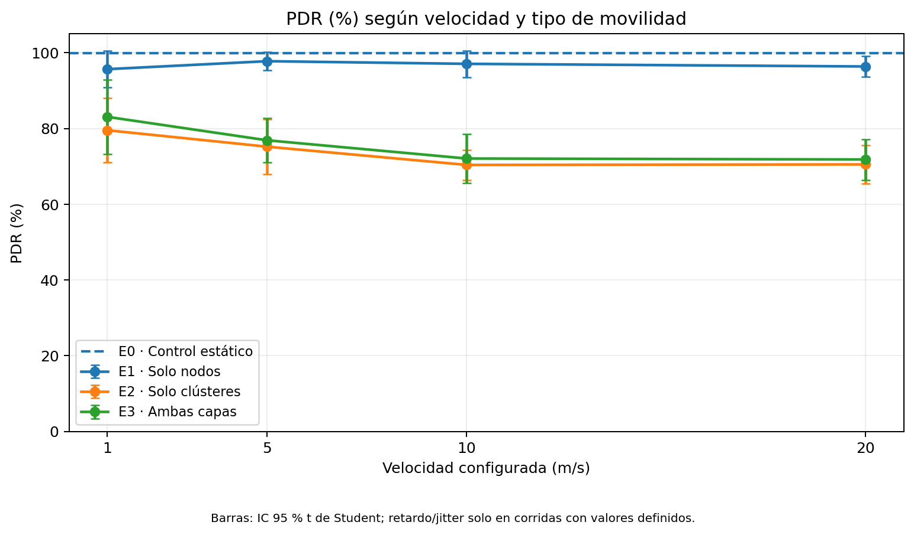
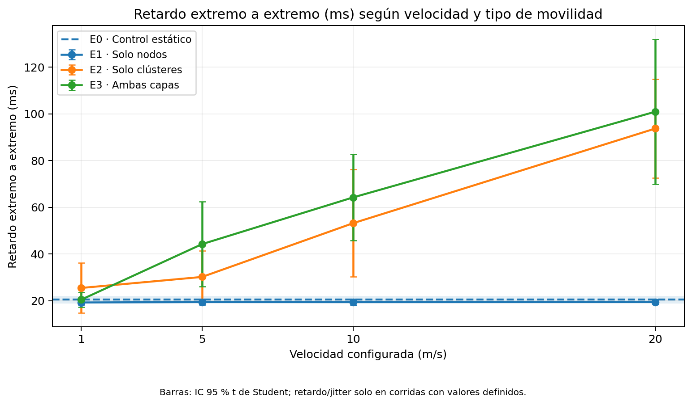
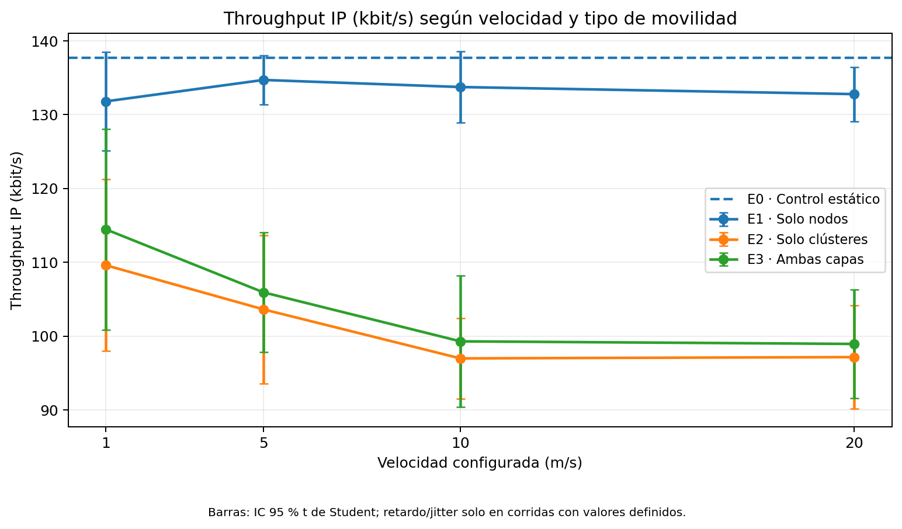
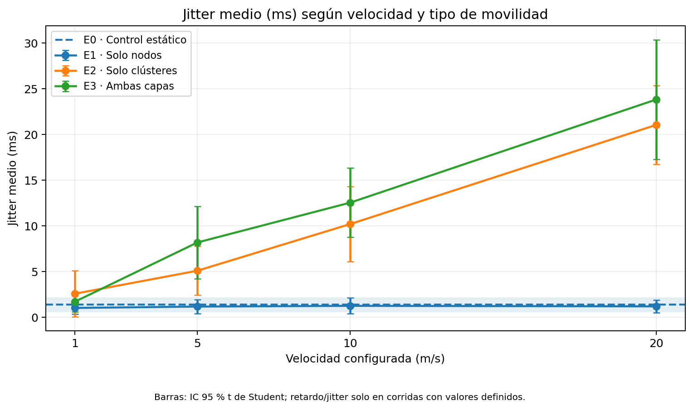
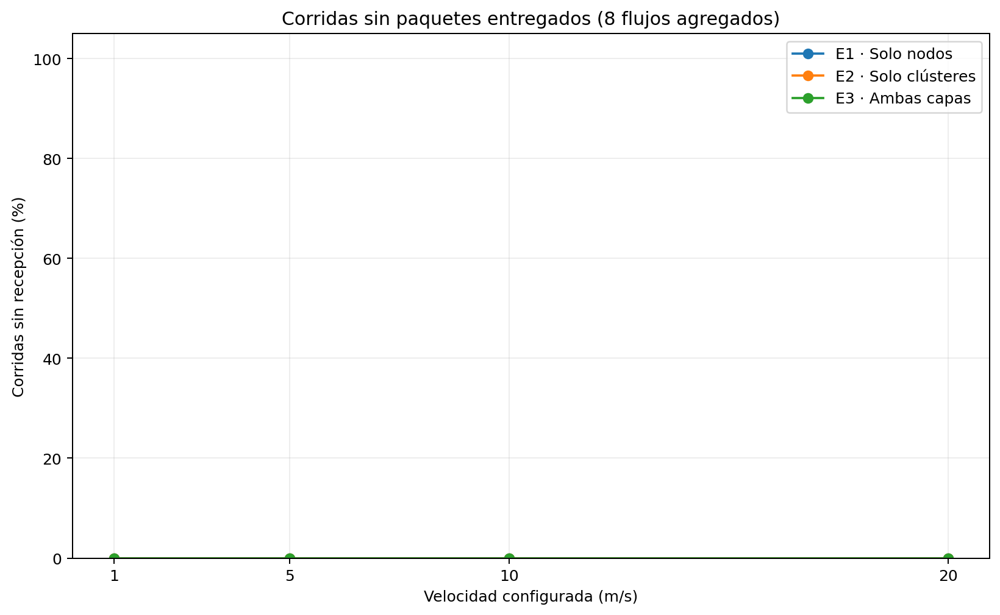

# Parte 4 — Resultados de simulación MANET

> **Generado automáticamente desde `resultados/resumen.csv`.** No es una conclusión estadística definitiva.

Se analizaron exclusivamente los **8 flujos UDP de datos** con puertos de destino **5000–5007**. Los flujos de control AODV (puerto **654**) se excluyeron de PDR, retardo, throughput y jitter. Por esa razón los valores **no deben coincidir** con el resumen global que imprime el programa ns-3 en consola.

## Figuras

## Tabla de resultados agregados

Cada fila corresponde a un escenario y velocidad. Los intervalos de confianza usan t de Student para las réplicas disponibles.

| escenario | velocidad | pdr_pct_media | pdr_pct_ic95_inf | pdr_pct_ic95_sup | retardo_ms_media | retardo_ms_n | corridas_sin_rx |
| --- | --- | --- | --- | --- | --- | --- | --- |
| E0 | 0 | 99.97 | 99.93 | 100.01 | 20.41 | 10 | 0 |
| E1 | 1 | 95.67 | 90.82 | 100.53 | 19.24 | 10 | 0 |
| E1 | 5 | 97.78 | 95.37 | 100.19 | 19.41 | 10 | 0 |
| E1 | 10 | 97.08 | 93.57 | 100.60 | 19.39 | 10 | 0 |
| E1 | 20 | 96.39 | 93.72 | 99.05 | 19.41 | 10 | 0 |
| E2 | 1 | 79.55 | 71.11 | 87.98 | 25.45 | 10 | 0 |
| E2 | 5 | 75.21 | 67.91 | 82.50 | 30.17 | 10 | 0 |
| E2 | 10 | 70.39 | 66.43 | 74.34 | 53.20 | 10 | 0 |
| E2 | 20 | 70.51 | 65.44 | 75.59 | 93.72 | 10 | 0 |
| E3 | 1 | 83.09 | 73.22 | 92.96 | 20.44 | 10 | 0 |
| E3 | 5 | 76.90 | 71.01 | 82.79 | 44.22 | 10 | 0 |
| E3 | 10 | 72.08 | 65.60 | 78.56 | 64.23 | 10 | 0 |
| E3 | 20 | 71.82 | 66.45 | 77.20 | 100.93 | 10 | 0 |

## Contrastes estadísticos

Consultar `comparacion_E2_vs_E1.csv`: prueba t de Welch **unilateral** por velocidad; E2 tiene menor PDR o mayor retardo que E1. α = 0.05, sin ajuste por comparaciones múltiples. Los valores de retardo se calculan únicamente en corridas con paquetes recibidos.

## Limitaciones a documentar

- Los clústeres utilizan **Random Waypoint con pausa fija de 2 segundos** al llegar a un destino. Según la validación del grupo, las pausas representan aproximadamente **4 % a 1 m/s y 21 % a 20 m/s**; por tanto, la velocidad configurada no equivale a la velocidad media efectiva.
- Las métricas son agregadas para ocho pares de comunicación. No deben compararse con conteos globales que incluyan tráfico AODV.
- Si ningún paquete llega, el **retardo y jitter no son calculables** (celdas vacías), no cero.
- El throughput de los 8 flujos usa bytes IP (`rxBytes`) y un intervalo común de **185 s** (desde 10 hasta 195 s para simulaciones de 200 s).
- Los resultados dependen de la geometría, la propagación, los flujos y el protocolo AODV elegidos. No generalizar a todas las MANET.
